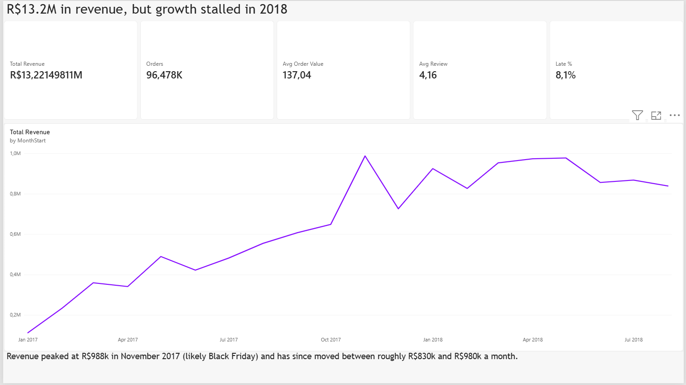
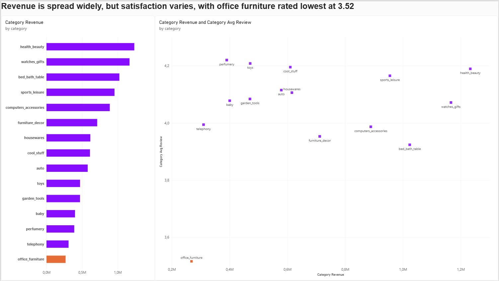
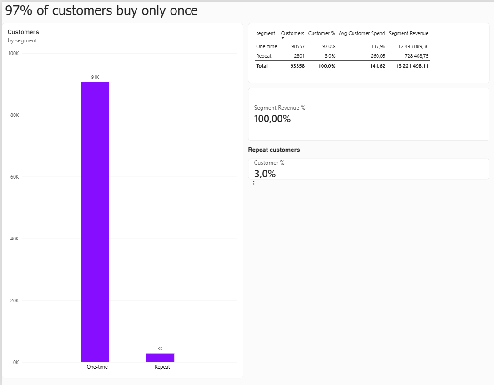
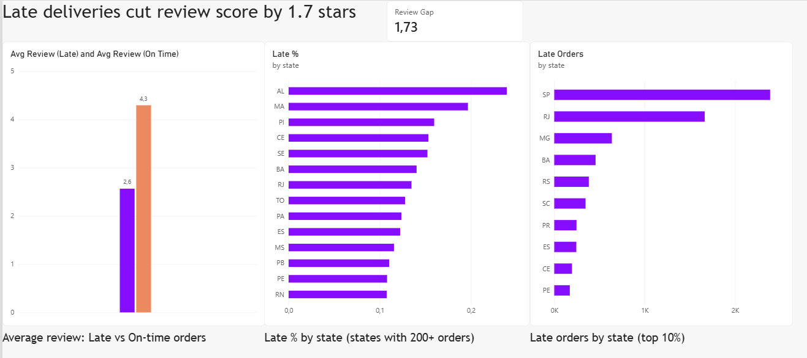

# Olist E-Commerce Analysis: Revenue, Retention and Delivery

An end-to-end SQL Server analysis of a Brazilian online marketplace. I modelled and cleaned the raw data, answered four business questions in T-SQL, and turned the results into recommendations.

**Headline finding:** orders delivered later than promised average **2.57 stars**, against **4.29 stars** for on-time orders, and only **3% of customers ever order twice**.

## Business questions

1. Which product categories drive the most revenue, and how do customers rate them?
2. How does monthly revenue trend, and how fast is it growing?
3. What share of customers order more than once, and what are they worth?
4. Which states get the slowest and least reliable delivery, and does lateness hurt reviews?

## Dataset

[Brazilian E-Commerce Public Dataset by Olist](https://www.kaggle.com/datasets/olistbr/brazilian-ecommerce) (Kaggle): about 99,000 orders from 2016 to 2018 across customers, orders, order items, payments, reviews, products and sellers. All money values are in Brazilian reais (BRL).

| Table | Rows loaded |
|---|---|
| Customers | 99,441 |
| Orders | 99,441 |
| Order items | 112,650 |
| Order payments | 103,886 |
| Order reviews (raw) | 99,224 |
| Products | 32,951 |
| Sellers | 3,095 |
| Category translations | 71 |

## Tools

SQL Server Express, SQL Server Management Studio (SSMS), T-SQL. [Power BI, once the dashboard is built.]

## Repository structure

```
/sql
  01_setup_and_load.sql      Creates the database and bulk loads the CSVs into staging tables
  01b_load_remaining.sql     Reloads the files that the first script could not (see "How to run")
  02_clean_and_model.sql     Cleans the staging data into typed tables with primary and foreign keys
  03_analysis.sql            The four business questions
README.md
```

## Data model

[Insert ERD image here.]

Orders link to customers. Order items link orders to products and sellers. Payments and reviews link back to orders. Every table has a primary key, and foreign keys enforce the links.

## Data cleaning log

| Issue found | Count | What I did | Effect on results |
|---|---|---|---|
| Orders with no items | 775 | Kept in the orders table | None. Analysis joins through order items and filters to delivered orders. [Add the status breakdown once you have run the check query.] |
| Delivered orders with no delivery date | 8 | Excluded from delivery-time queries | Negligible |
| Products with no category | 610 | Labelled `unknown` instead of dropping | Their revenue still counts in totals |
| Orders without a review | 768 | Kept, using LEFT JOINs | Counted in revenue, excluded from average review scores |
| Duplicate and multiple reviews per order | n/a | Kept the most recent review per order | Prevents joins from duplicating rows and inflating revenue |
| Portuguese category names | n/a | Translated to English using the translation table | Readability only |

Two traps worth noting:
- `customer_id` is unique **per order**, not per person. Retention analysis uses `customer_unique_id`.
- The raw reviews file contains free-text comments with line breaks, which broke the standard bulk load (see below).

## Definitions

- **Revenue:** sum of item price on orders with status `delivered`, excluding freight.
- **Late order:** delivered after the estimated delivery date shown to the customer.
- **Repeat customer:** a `customer_unique_id` with two or more delivered orders.
- **Delivery days:** days from purchase to delivery to the customer.

## Findings

### 1. Revenue is spread across many categories, but satisfaction varies

The top 15 categories make up about 76% of total revenue, and no single category makes up more than about 9.3%. Health and beauty leads (9.33% of revenue, rated 4.19), followed by watches and gifts (8.82%, 4.07) and bed, bath and table (7.74%, 3.92).

Ratings differ more than revenue shares do. Bed, bath and table has the most orders (9,272) but one of the lower ratings, while toys and perfumery rate around 4.2. Office furniture is the weakest at **3.52**, which is the lowest of the 15.

*Recommendation:* investigate why office furniture is rated lowest. I have not yet tested whether late delivery explains it, so this remains an open question.

### 2. Rapid growth in 2017, then a plateau in 2018

2016 is too sparse to use (two months have a single order, and there is no November), so the trend starts in January 2017.

- Monthly revenue grew from about R$112k in January 2017 to a peak of **R$988k in November 2017** (up 52% on the month). The spike is likely Black Friday, though the data cannot confirm it.
- December 2017 fell 26.5%.
- From January to May 2018, revenue sat between about R$925k and R$978k a month, then slipped to about R$839k by August 2018.
- Total revenue across the period was **R$13.22M**.

*Recommendation:* the growth story ends in 2018. Understanding what changed after May 2018, such as acquisition, seasonality or delivery problems, would be the first thing to look into.

### 3. Almost nobody comes back

| Segment | Customers | Share | Avg total spend | Revenue |
|---|---|---|---|---|
| One-time | 90,557 | 97.0% | R$137.96 | R$12.49M |
| Repeat | 2,801 | 3.0% | R$260.05 | R$0.73M |

Repeat customers spent more in total mainly because they ordered more than once, not because each order was larger. They account for only about 5.5% of revenue.

As a check, the two segments add up to R$13,221,498, which matches the running total in the monthly revenue query.

*Recommendation:* with 97% of customers buying once, retention is the largest unused opportunity in the dataset. Even a small lift in repeat purchase would add meaningful revenue.

### 4. Late deliveries are what hurt reviews

| Delivery | Orders | Avg review |
|---|---|---|
| On time | 88,163 | 4.29 |
| Late | 7,661 | 2.57 |

About 8% of delivered orders arrive late, and those orders score about 1.7 stars lower. This is an association, not proof of cause, but the gap is large.

By state, the worst late rates are in the north-east: Alagoas (23.9% late, 24.5 days average delivery) and Maranhão (19.7% late). Review scores in those states are only slightly lower than in the best-performing states, so lateness itself matters more than location.

Volume changes the priority. São Paulo has the most late orders by far (roughly 2,400), followed by Rio de Janeiro (roughly 1,650, from a 13.5% late rate on 12,350 orders) and Minas Gerais (roughly 600). Alagoas has the highest late rate but only about 95 late orders. Ranking by late rate alone would aim effort at the wrong places.

*Recommendation:* prioritise delivery performance in the highest-volume states first (São Paulo and Rio de Janeiro), and set more realistic delivery estimates so promises match what carriers actually achieve.

## Summary of recommendations

1. Fix delivery reliability where late order volume is highest, and make delivery estimates more realistic.
2. Build a retention programme, since only 3% of customers return.
3. Investigate the lowest-rated categories, starting with office furniture.
4. Examine what changed after May 2018 to explain the revenue plateau.

## Limitations

- The most recent months may be slightly understated, because orders are filtered by delivered status but grouped by purchase month.
- Review scores are only available for customers who chose to leave one.
- Findings are associations from observational data and do not prove cause.
- Revenue excludes freight, and figures are in BRL.

## Dashboard







## How to run

1. Download the dataset from Kaggle and unzip the CSVs into a folder such as `C:\olist\`.
2. Make sure the SQL Server service account has read permission on that folder.
3. Open `01_setup_and_load.sql` in SSMS, set the `@path` line to your folder (with a trailing backslash) and run it.
4. The bulk load stopped on the reviews file because of multi-line comments. `01b_load_remaining.sql` loads the remaining files and retries reviews without a fixed row terminator. Run it if the first script errors.
5. Run `02_clean_and_model.sql`, then run the queries in `03_analysis.sql` one at a time.

Requires SQL Server 2017 or later.

## About me

Priyanka Govender, Computer and Information Sciences student (Application Development) at The IIE Emeris. I'm building towards data analysis, business analysis and UI/UX design.

(https://www.linkedin.com/in/priyankagov22/)
